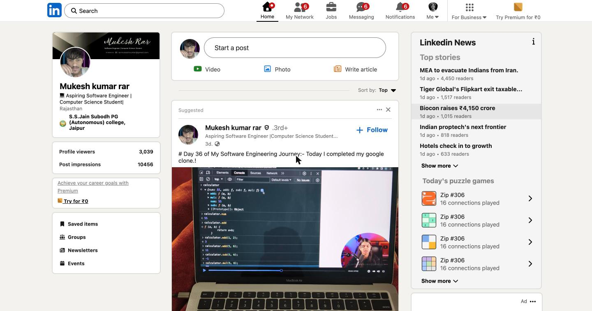

# LinkedIn — layout clone

A front-end recreation of the LinkedIn interface, built with HTML and CSS to practise layout work. No JavaScript, no framework — the whole thing is markup and stylesheet.

**Live demo:** _(enable GitHub Pages on this repo and put the link here)_

> A learning project. Not affiliated with, endorsed by, or connected to LinkedIn. All LinkedIn names and logos belong to their owner; they appear here only because the exercise was to reproduce the layout.

---

## Screenshot

<!-- Take a screenshot, save it as docs/screenshot.png, then uncomment: -->
<!--  -->

## What it covers

- Three-column feed layout: profile sidebar, post feed, suggestions rail
- Navigation bar with icon set
- Post cards, profile card, and footer
- The largest CSS file of the set, since the column behaviour drives most of it

Roughly 517 lines of HTML and 1260 of CSS.

## Run it

```bash
git clone https://github.com/mukeshkumar-1024/linkedin-clone.git
cd linkedin-clone
open index.html        # or just double-click the file
```

## Publish it

1. Repo → **Settings** → **Pages**
2. **Source**: Deploy from a branch · Branch **main** · folder **/ (root)** · **Save**
3. Live at `https://mukeshkumar-1024.github.io/linkedin-clone/`

A layout project is worth far more with a live link than without one — this is the single most useful thing to do to this repo.

## License

The HTML and CSS here are MIT licensed — see [LICENSE](LICENSE). The images and logos under `assets/` are not mine and are not covered by that license.

## Author

Mukesh Kumar — [GitHub](https://github.com/mukeshkumar-1024) · [LinkedIn](https://linkedin.com/in/mukesh-choudhary-64a9a4378)
